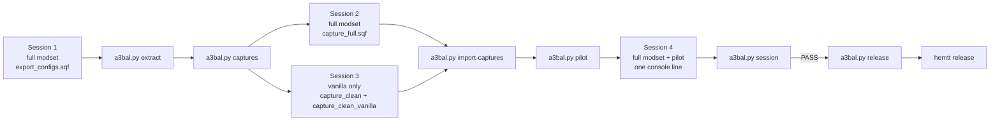

# Make your own balancing patch

The pipeline reads your modset's configs, classifies every helmet, vest,
uniform and rifle round, drafts the changes, and builds a test mod that checks
itself in game. Nothing is installed or overwritten along the way: each step
writes a new folder, and the release config is only written after the in-game
check passes.

## What you need

- Arma 3 with your modset, and the Eden editor.
- Python 3.11 or newer. No packages.
- [HEMTT](https://hemtt.dev) for the final build (see [BUILDING.md](BUILDING.md)).
- Disk space: the first export of a large modset writes several GB of RPT.

All commands run from `tools/`. Arma's RPT logs are in
`%LOCALAPPDATA%\Arma 3\`; each Arma start writes a new one. Note which RPT
belongs to which session.

## Overview



Sessions 1, 2 and 4 use your full modset. Session 3 uses vanilla Arma only, so
the pipeline can check that the vanilla values it copies are really vanilla's
and not a mod's override.

Every in-game step is the same: open Eden on a small map (VR is fine), place a
player unit, start the preview, open the debug console (Esc), paste the script,
press **LOCAL EXEC**, and wait for the hint that says it finished. To copy a
script:

```powershell
Get-Content export_configs.sqf -Raw | Set-Clipboard
```

## 1. Export your modset

**Session 1, full modset:** run `tools/export_configs.sqf`. It writes every
weapon, magazine, ammo, glasses, patch and vehicle class into the RPT. For an
80-mod preset that is about 57,000 classes and 5.6 GB of log, and it takes a
while. Then:

```powershell
python a3bal.py extract "<path to session 1 RPT>"
```

This writes `data-recovered/`: the parsed configs, a wearables spreadsheet
(`wearables.csv`) and an audit of protection profiles (`audit/`). A few
damaged records are skipped and listed in `data-recovered/summary.json`.

## 2. Draft and prepare the captures

```powershell
python a3bal.py captures
```

This drafts a first proposal (`proposal/`) and writes two capture scripts from
it:

- `validation/remaining/capture_full.sqf` records which weapons and vehicles
  fire each magazine. Rifle rounds only change once their use is known.
- `validation/remaining/capture_clean.sqf` and
  `validation/capture_clean_vanilla.sqf` record the vanilla reference values.

**Session 2, full modset:** run `capture_full.sqf`.

**Session 3, vanilla only:** disable every mod, including Creator DLC, and
restart Arma. Run `capture_clean.sqf`, wait for its hint, then run
`capture_clean_vanilla.sqf` in the same session. Both refuse to run if any mod
is loaded.

```powershell
python a3bal.py import-captures --full "<session 2 RPT>" --clean "<session 3 RPT>"
```

## 3. Review the draft

Before building, look at what the draft decided:

| File | What it shows |
|---|---|
| `proposal/change_ledger.csv` | every value that will change: class, path, old, new, rule |
| `proposal/UNRESOLVED_FAMILIES.md` | gear the rules could not identify, ranked by how many items it covers |
| `proposal/coverage.csv` | what happened to every class, including those left alone |
| `proposal/wearable_targets.csv` | the tier chosen for each vest and uniform |
| `proposal/ammunition_mapping.csv` | each round's cartridge, type and target values |
| `equipment.sqlite` | everything above as SQL views; `queries.sql` has examples |

Unidentified gear is capped at vanilla's best rather than guessed, so the draft
is safe to test even with unresolved families. To identify them, add their names
to the patterns below and run the next step again.

### Where to change the rules

| What | Where |
|---|---|
| Helmet tiers (values and anchors) | `draft_balance.py`: `HELMET_TIERS`, `ARMOR_ANCHORS` |
| Helmet identification | `draft_balance.py`: `MODERN`, `STEEL`, `CREW`, `HELI_AIRCREW`, `JET_PILOT`, `HEAVY`, `RACING`, `HARD_HAT`, `EXCLUDED` |
| Vest identification | `wearable_targets.py`: `FLAK`, `LIGHT_CARRIER`, `HEAVY_ARMOR`; the cap is `VEST_CEILING` |
| Vest tier values | the vanilla vests in `draft_balance.py` `ARMOR_ANCHORS` |
| Cartridges and their reference rounds | `ammunition_policy.py`: `FAMILIES` (vanilla ball, then the mod's ball) |
| AP, enhanced and match multipliers | `ammunition_policy.py`: `LADDER`, `HIT_RATIO_LIMITS` |
| Rounds named explicitly | `ammunition_policy.py`: `IDENTIFIED`, `ORDINARY_BALL`, `SHORT_GENERIC` |
| Mods whose rounds use RHS's damage scale | `ammunition_policy.py`: `RHS_SCALE_PREFIXES` |
| A vanilla value your modset overrides on purpose (ACE's 7.62x54R speed) | `build_balance_pilot.py`: `LOADED_REFERENCE` |

The ammunition part is built around RHS: each cartridge pairs a vanilla ball
with RHS's ball. With a different ammunition mod, change the second name in each
`FAMILIES` entry. Every target value must be a real vanilla value; the pilot
build refuses any wearable value that doesn't match the clean vanilla capture.

Run the tests after changing rules: `python -m unittest discover -q`.

## 4. Build the test mod

```powershell
python a3bal.py pilot
```

This drafts again (now with the capture data), builds the query database,
checks the vanilla references against session 3, prepares the acceptance test
and builds `balance-pilot/@A3Balance_Pilot`. The pilot is an ordinary local mod
with every change, plus its own test scripts.

To rebuild after changing rules, delete `balance-pilot/` first: builds never
overwrite each other.

## 5. Test it in one session

**Session 4, full modset plus the pilot:** add
`tools/balance-pilot/@A3Balance_Pilot` as a local mod, start an Eden preview,
and run this one line in the debug console:

```sqf
[] execVM "\a3bal_pilot\tests\run.sqf";
```

Leave it for about an hour until the hint says **Balance pilot session
complete**. It runs two checks:

1. **Config:** every changed class, field by field, against what the pipeline
   expects, including inheritance. Any difference is a failure.
2. **Damage:** spawns AI targets and shoots them at point-blank range with ACE
   medical, counting shots until they go down. Patched mod rounds go against
   vanilla vests and helmets, and vanilla rounds against patched mod gear. Each
   should take the same number of shots as its vanilla equivalent, within one
   shot. AP and enhanced rounds, a grenade check on uniforms and a held civilian
   uniform are measured for review but don't fail the test.

```powershell
python a3bal.py session "<session 4 RPT>"
```

The report is `validation/session/ACCEPTANCE.md`, headed **PASS** or **NEEDS
REVIEW**. Example: [the 2026-10-24 report](results/SESSION_2026-10-24.md).

## 6. Release

```powershell
python a3bal.py release
cd ..
hemtt release
```

`release` refuses unless the session passed for this exact pilot build. It
writes `addons/main/config.cpp` and `release.json`. HEMTT then builds and signs
the mod. To rename the addon, change `prefix` in `.hemtt/project.toml` and
`ADDON` in `tools/build_release.py`.

## After a mod update

Mods change their configs between versions, and the patch copies values from
the versions it was built against. After an update, redo the whole run:
sessions 1 to 4. Delete or rename the old `data-recovered/`, `validation/` and
`balance-pilot/` first.

## Status of the scripts

Every step except one was used to build the released patch, and the repository
reproduces that build byte for byte from the same captures. The exception is
`export_configs.sqf`, which was rewritten for this repository because the
original export script was not kept. It writes the same record format the
extractor reads, and it compiles cleanly with HEMTT, but it has not run in Arma
yet. If its import reports problems, open an issue with the summary from
`data-recovered/summary.json`.
